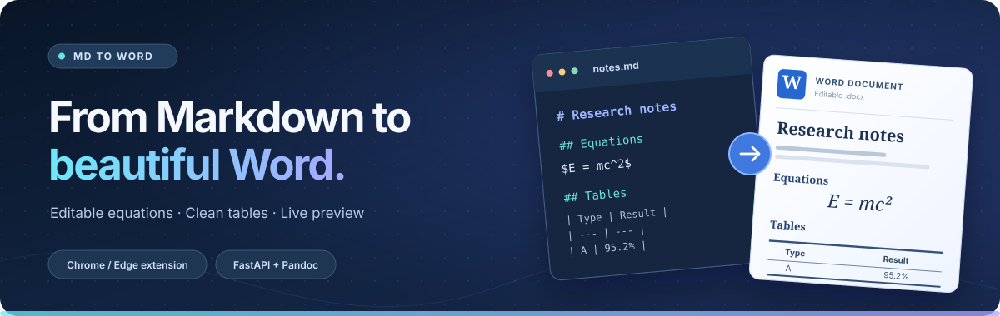

  

  # MD To Word

  **把 AI 回答，变成真正可编辑、排版规范的 Word 文档。**

  复制 ChatGPT、Claude、DeepSeek 等网页中的内容，粘贴到浏览器侧边栏，预览后导出 `.docx`。  
  **三线表 · 原生 Word 公式 · 中文排版 · Markdown 自动修复**

  

    
    
    
  

  

    
    
    
    
  

  <a href="#features">特色功能</a> · <a href="#quick-start">快速开始</a> · <a href="#architecture">技术架构</a> · <a href="#development">本地开发</a>

---

## 为什么做 MD To Word？

AI 给出的内容在网页中排版整齐，复制进 Word 却经常变成一堆需要手动整理的 Markdown。

| 常见痛点 | MD To Word 的处理方式 |
| :-- | :-- |
| 表格变成竖线和分隔符 | 转为 **Word 原生三线表** |
| 公式变成乱码或只能截图 | 转为 **可继续编辑的 Word 公式（OMML）** |
| `#`、`##` 标题没有层级 | 映射为 **Word 标题样式** |
| 混杂不规范的 Markdown 写法 | **预览与导出前统一归一化** |
| 长篇内容需要反复拼接 | **文件夹管理 + 多对话按顺序合并导出** |

## ✨ 特色功能

<table>
  <tr>
    <td width="50%" valign="top">
      <h3>🧮 可编辑数学公式</h3>
      行内、块级公式转换为 Word 原生 OMML，不是截图；在 Word 中仍可编辑。
    </td>
    <td width="50%" valign="top">
      <h3>📊 学术三线表</h3>
      Markdown 表格转换为 Word 表格，并应用上下粗线、表头下细线的三线表样式。
    </td>
  </tr>
  <tr>
    <td valign="top">
      <h3>👀 实时预览</h3>
      基于 markdown-it 与 KaTeX 预览标题、表格和公式；导出前先检查内容。
    </td>
    <td valign="top">
      <h3>📝 中文文档排版</h3>
      基于 `reference.docx` 配置正文宋体、标题黑体、1.5 倍行距等常用样式。
    </td>
  </tr>
  <tr>
    <td valign="top">
      <h3>🗂️ 多文件组织与合并</h3>
      文件夹内保存多个 Markdown 对话框，按选择编号决定合并与导出顺序。
    </td>
    <td valign="top">
      <h3>🔀 Mermaid 流程图</h3>
      后端将 Mermaid 渲染为 PNG 并插入 Word；流程图可显示，但不可作为图形对象编辑。
    </td>
  </tr>
  <tr>
    <td valign="top">
      <h3>🛡️ 非标准 Markdown 兜底</h3>
      兼容常见的公式定界符、下标、表格分隔线和标题格式等异常写法。
    </td>
    <td valign="top">
      <h3>💬 反馈与修复流程</h3>
      内置问题反馈入口；后端缺陷可交由 Agent 复现和验证，成功后生成待审核 PR。
    </td>
  </tr>
</table>

> **预览接近导出效果。** 前端 `extension/src/normalizer.ts` 与后端 `backend/app/normalizer.py` 采用一致的归一化规则；Word 的实际字体布局仍以导出文件为准。

## 🚀 快速开始

### 方法一：直接安装 Edge 扩展

  

| 步骤 | 操作 |
| :--: | :-- |
| **01** | 安装扩展，点击浏览器工具栏图标打开侧边栏。 |
| **02** | 复制 AI 网页回答，粘贴到对话框；需要时可以创建文件夹或导入 `.md` 文件。 |
| **03** | 预览标题、公式和表格，选好导出顺序，点击 **导出 Word**。 |

### 方法二：本地加载扩展（Chrome / Edge）

<strong>展开查看开发者模式安装步骤</strong>

1. 在 `extension/` 目录执行 `npm install && npm run build`。
2. 打开 `chrome://extensions` 或 `edge://extensions`。
3. 启用「开发者模式」，点击「加载已解压的扩展程序」。
4. 选择 `extension/dist`，随后打开侧边栏使用。

> 扩展默认连接线上转换服务；如需自建服务，可将地址改为 `http://127.0.0.1:8000`。

## 🛡️ Markdown 兼容与修复

网页 AI 输出并不总是标准 Markdown。MD To Word 会在转换前修复常见格式问题，尽量降低手动整理成本。

| 输入中的常见问题 | 处理方式 |
| :-- | :-- |
| 块公式 `\[…\]`、独立的裸方括号块 | 归一化为 `$$…$$` |
| 行内公式 `\(…\)`、特定 AI 公式 `(z_T)` | 归一化为 `$…$`；普通括号文本不变 |
| 错误下标 `*{LL}` / `*2` | 修复为 `_{LL}` / `_2` |
| `#标题` 没有空格 | 修复为 `# 标题` |
| 表格前缺空行、使用 `｜` 和中文破折号 | 修复空行、分隔符与表格分隔行 |
| 列表前缺空行 | 通过 Pandoc `lists_without_preceding_blankline` 兼容 |
| 独立的 `---` 行 | 转义，避免误识别为 YAML 元数据 |
| 高大括号、分数、范数等公式定界符 | 尝试调整定界符大小以改善 Word 显示 |

<strong>查看化学公式支持范围与导出自检</strong>

- 数学定界符内的独立 `\ce{...}` 支持分子式、括号分组、离子电荷和反应箭头。例如：`$\ce{Ca(OH)2}$`、`$\ce{SO4^2-}$`、`$\ce{2H2 + O2 -> 2H2O}$`。
- 反应物之间的加号两侧需要留空格，带数值的电荷用 `^` 标记。
- 超出支持范围的化学公式（如嵌套公式、带条件箭头）在预览和 Word 导出中保留为原始文本，不强行错误解析。
- 导出后会检查未解析的表格残留；检测到异常时在后端日志中告警。

## 🧱 技术架构

~~~mermaid
flowchart LR
    A["AI 网页内容"] --> B["浏览器侧边栏 React · TypeScript"]
    B -->|"实时预览"| P["markdown-it · KaTeX"]
    B -->|"POST /convert"| C["FastAPI Markdown 归一化"]
    C --> D["Mermaid 渲染 需要时生成 PNG"]
    D --> E["Pandoc + reference.docx"]
    E --> F["三线表后处理 导出自检"]
    F --> G["可编辑 .docx"]
    classDef accent fill:#eaf3ff,stroke:#5b8fe8,color:#17345b;
    class B,C,E,G accent;
~~~

| 目录 | 职责 |
| :-- | :-- |
| [`extension/`](extension/) | Chrome / Edge Manifest V3 侧边栏，编辑与实时预览 |
| [`backend/`](backend/) | FastAPI、Pandoc、归一化、三线表处理与 DOCX 导出 |
| [`agent/`](agent/) | 用户反馈分类、缺陷复现、补丁生成、验证与 PR 发布 |
| [`trace-site/`](trace-site/) | 脱敏运行记录与 Agent 执行过程展示 |
| [`docs/`](docs/) | Agent 权威需求、维护者指南与设计说明 |

### 🤖 反馈驱动的 Agent

用户提交反馈后，系统可以将后端缺陷交由 Agent 复现、生成修复并进行独立验证；**仅在验证通过后创建 PR，由维护者审核**。功能建议与前端问题走脱敏 Issue 路径，不自动修改扩展、合并代码或部署。

相关设计：[部署与运行方式](docs/AgentRequirements/deployment-and-operations.md) · [维护者指南](docs/AgentGuide/README.md) · [面试问题整理](docs/AgentProblem/InterviewGuide/agent-interview-questions.md)

## 🛠️ 本地开发与验证

<strong>后端服务 · FastAPI / Pandoc</strong>

~~~bash
cd backend
uv venv .venv
uv pip install -e ".[dev]"
.venv/bin/uvicorn app.main:app --reload
.venv/bin/python -m pytest -v
~~~

Pandoc 用于 DOCX 转换。开发依赖中包含 `pypandoc_binary`，本地非 Mermaid 测试无需额外安装 Pandoc。需要真实验证 Mermaid 转换时，建议使用后端 Docker 镜像，以确保 CLI、Chromium 和中文字体版本一致。

<strong>浏览器扩展 · React / TypeScript</strong>

~~~bash
cd extension
npm install
npm run dev
npm run build
~~~

`dist` 为构建产物，用于本地加载扩展，不提交到仓库。

<strong>Docker 构建与部署说明</strong>

~~~bash
cd backend
docker build -t md-to-word-backend .
~~~

- 后端从 `backend/` 部署至 Render，健康检查路径为 `/health`。
- 扩展无需部署到 Render；重新构建并在浏览器的扩展管理页面刷新即可。
- Render 的后端容器已包含 Mermaid CLI 与 Chromium，使用线上转换服务不需要开启本地 Docker。
- Agent Sandbox 应在私有运行环境中与公开转换后端隔离；详见[部署与运行方式](docs/AgentRequirements/deployment-and-operations.md)。

<strong>Word 导出人工验收清单</strong>

- [ ] 正文文字可读，中文排版和样式正常
- [ ] 表格是 Word 原生表格，三线表样式正确
- [ ] 数学公式是可编辑的 Word 公式，而非图片
- [ ] Mermaid 图作为清晰图片显示（图形不可编辑）
- [ ] `#` 至 `######` 映射到正确标题层级，超过六级降为正文

---

  
<strong>让 AI 负责生成内容，让 MD To Word 负责文档排版。</strong>

  
适用于论文、课程作业、工作报告以及技术文档。

  
<a href="https://microsoftedge.microsoft.com/addons/detail/md-to-word/cippambdocmalcoceomjlibolaeicmoe?hl=zh-CN">Edge 扩展</a> · <a href="https://github.com/yyqqCoding/MDToWord/issues">问题反馈</a> · <a href="https://linux.do">LinuxDO</a>

